Enlace del video: https://youtu.be/Ah72Usq0fmA

# Hardening de red con CIS Benchmark

El objetivo de este laboratorio es auditar un router, un switch y un firewall contra recomendaciones del CIS Benchmark, aplicar un subconjunto de esas recomendaciones y comprobar el resultado. La auditoría y la aplicación se automatizan con un script propio que genera un informe en dos modos: solo auditoría, y aplicación con informe posterior.

---

## Topología

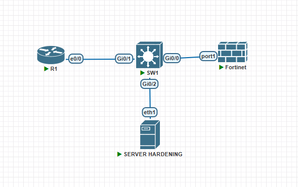

| Dispositivo | Rol |
|-------------|-----|
| R1 (Cisco IOL) | Equipo a endurecer |
| SW1 (Cisco vIOS-L2) | Equipo a endurecer |
| FortiGate | Equipo a endurecer |
| Ubuntu (Servidor Hardening) | Máquina de gestión. Ejecuta el script |

---

## Versiones de los dispositivos

| Dispositivo | Imagen / Versión |
|-------------|------------------|
| Router | Cisco IOL `i86bi_Linux-L3-AdvEnterpriseK9-M2_157_3_May_2018` (IOS 15.7(3)M2) |
| Switch | Cisco vIOS-L2 `viosl2-adventerprisek9-m.ssa.high_iron_20200929` (versión: 15.2) |
| Firewall | FortiGate-VM64-KVM, FortiOS 7.0.9 |
| Servidor Hardening | Ubuntu 20.04 (`pnetlab/ubuntu_sv`), Python 3.8, Netmiko 4.4.0, PyYAML |
| Plataforma | PNetLab (versión: 4.2.10) |

---

## Direccionamiento

Matricula: 2025-1410

Red base `14.10.0.0/16` (últimos 4 dígitos de la matrícula).

| Segmento | Red | Máscara | Rango útil |
|----------|-----|---------|------------|
| Gestión | 14.10.10.0/28 | 255.255.255.240 | 14.10.10.1 - 14.10.10.14 |

| Dispositivo | Interfaz | IP |
|-------------|----------|----|
| R1 | e0/0 | 14.10.10.1/28 |
| Ubuntu | eth1 | 14.10.10.2/28 |
| SW1 | Vlan1 | 14.10.10.3/28 |
| FortiGate | port1 | 14.10.10.4/28 |

### Interfaces

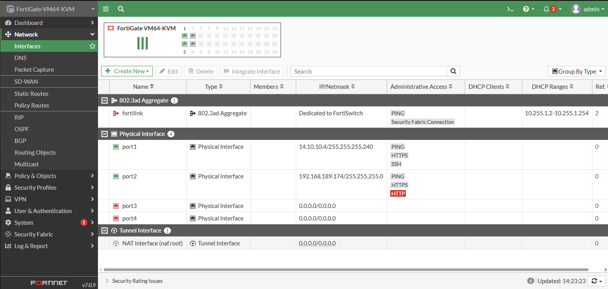

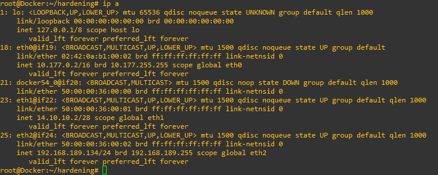

---

## Preparación del acceso

Los tres equipos se configuraron con SSH versión 2 y un usuario dedicado para el script (`auditor`), con privilegios de administración. En el FortiGate el usuario tiene el perfil `super_admin`.

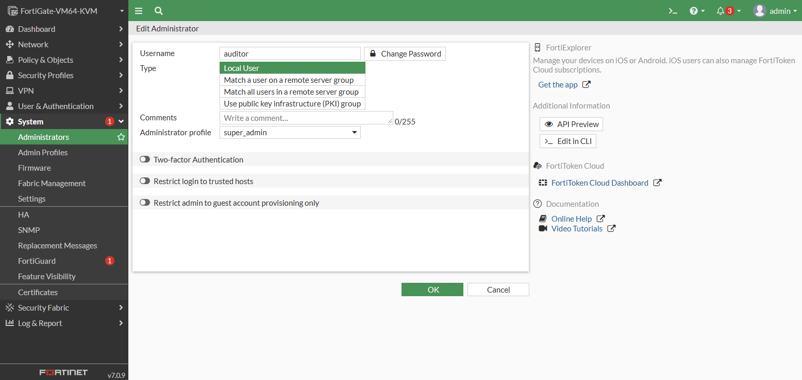

---

## Herramienta utilizada

Se desarrolló un **script propio en Python** que audita y aplica las recomendaciones.

| Componente | Uso |
|------------|-----|
| Python 3 | Lenguaje del script |
| Netmiko 4.4.0 | Conexión SSH a los equipos Cisco y FortiGate |
| PyYAML | Lectura de las reglas y de los dispositivos |

Archivos:

| Archivo | Contenido |
|---------|-----------|
| `auditor.py` | Lógica de conexión, comprobación, aplicación e informes |
| `reglas.yaml` | Reglas por tipo de dispositivo: número CIS, comando, patrón de comprobación y comandos de corrección |
| `dispositivos.yaml` | IP, tipo y credenciales de cada equipo |

### Modos de uso

```bash
# Solo informe. No cambia nada en los equipos.
python3 auditor.py --modo audit

# Aplica las reglas que fallan, guarda y vuelve a auditar. Informe con antes y después.
python3 auditor.py --modo apply
```

Cada ejecución guarda un informe en Markdown y CSV, y una copia de la configuración de cada equipo (antes y después) en `salida/configs/`.

### Por qué una herramienta propia

- Permite elegir exactamente qué recomendaciones del benchmark se evalúan y se aplican.
- Una misma regla sirve para el modo de auditoría y el de aplicación.
- Las reglas se editan sin tocar el código.

---

## Benchmarks utilizados

| Equipo | Benchmark | Observación |
|--------|-----------|-------------|
| Router y switch | CIS Cisco IOS XE Benchmark v1.0.0 | No existe un benchmark de IOS 15 en la lista disponible. Se usó este como referencia porque los controles elegidos usan los mismos comandos. Fue probado en IOS XE 17.06, y el laboratorio usa IOS 15.x |
| FortiGate | CIS FortiGate 7.0.x Benchmark v1.4.0 | La sección de tecnología objetivo indica FortiOS 7.2 o superior. El laboratorio usa 7.0.9 |

Los PDF de los benchmarks no se incluyen en este repositorio, porque los términos de uso de CIS no permiten alojarlos en sitios de terceros.

---

## Recomendaciones aplicadas

### Router (R1) y switch (SW1)

Las mismas 22 reglas se evaluaron y aplicaron en ambos equipos.

| CIS | Recomendación | Por qué se aplicó |
|-----|---------------|-------------------|
| 1.4.1 | `enable secret` | Protege el modo privilegiado con un hash en vez de una contraseña reversible |
| 1.4.2 | `service password-encryption` | Evita que las contraseñas se lean en claro en la configuración |
| 1.4.3 | Usuarios locales con `secret` | Impide contraseñas de usuario almacenadas sin protección |
| 1.2.2 | `transport input ssh` en `line vty` | Solo se permite administración remota cifrada |
| 1.2.7 | `exec-timeout` en `line console 0` | Cierra sesiones de consola abandonadas |
| 1.2.8 | `exec-timeout` en `line vty` | Cierra sesiones remotas abandonadas |
| 1.2.11 | `login block-for 900 attempts 3 within 120` | Frena ataques de fuerza bruta sobre el inicio de sesión |
| 1.3.2 | Banner de login | Avisa de que el acceso es restringido y se registra |
| 2.1.1.1.4 | `ip ssh time-out` de 60 s o menos | Limita el tiempo de un inicio de sesión SSH sin completar |
| 2.1.1.1.5 | `ip ssh authentication-retries` de 3 o menos | Limita los intentos de contraseña por conexión |
| 2.1.1.2 | SSH versión 2 | La versión 1 tiene vulnerabilidades conocidas |
| 2.1.2 | `no cdp run` | CDP revela información del equipo a quien lo escuche |
| 2.1.3 | `no ip bootp server` | Servicio innecesario |
| 2.1.4 | `service tcp-keepalives-in` | Descarta sesiones entrantes que quedaron colgadas |
| 2.1.5 | `service tcp-keepalives-out` | Descarta sesiones salientes que quedaron colgadas |
| 2.1.6 | `no service pad` | Servicio heredado innecesario |
| 2.2.2 | `logging buffered` | Conserva un registro local de eventos |
| 2.2.3 | `logging console critical` | Limita lo que se envía a la consola |
| 2.2.6 | `service timestamps debug datetime` | Permite correlacionar eventos en el tiempo |
| 2.2.8 | `login on-failure log` y `login on-success log` | Registra los inicios de sesión correctos y fallidos |
| 3.1.1 | `no ip source-route` | El enrutamiento de origen se usa en varios ataques |

### FortiGate

| CIS | Recomendación | Por qué se aplicó |
|-----|---------------|-------------------|
| 2.1.1 | Banner previo al inicio de sesión | Avisa de que el acceso es restringido y se monitoriza |
| 2.1.8 | `ssl-static-key-ciphers` deshabilitado | Evita que las sesiones TLS usen claves estáticas |
| 2.2.1 | Política de contraseñas | Exige longitud mínima y complejidad en las contraseñas de administración |
| 2.2.2 | `admin-lockout-threshold 3` y `admin-lockout-duration 900` | Bloquea el acceso tras intentos fallidos repetidos |
| 2.4.4 | Tiempo de inactividad del administrador (`admintimeout`) | Cierra sesiones de administración abandonadas |
| 2.4.5 | Solo canales cifrados de administración | Quita `http` de `port2`. Quedan HTTPS y SSH |
| 3.2 | Políticas sin `ALL` como servicio | Cada política debe indicar qué servicios permite |

---

## Resultados

### Auditoría inicial (antes)

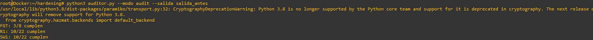

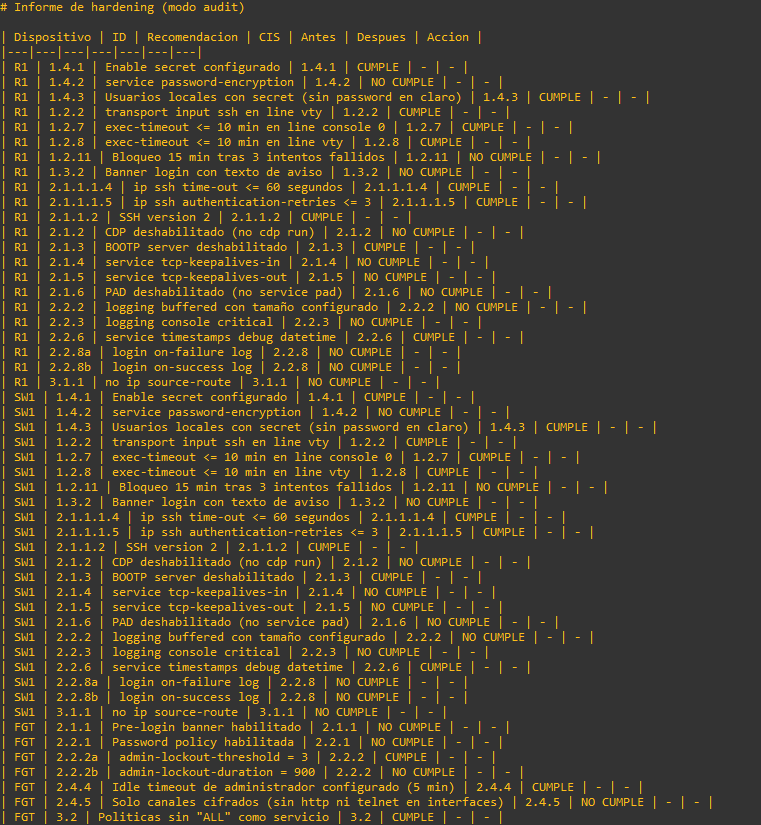

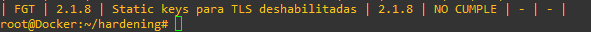

### Aplicación y auditoría posterior (después)

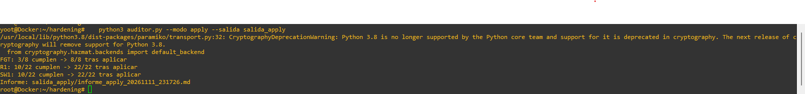

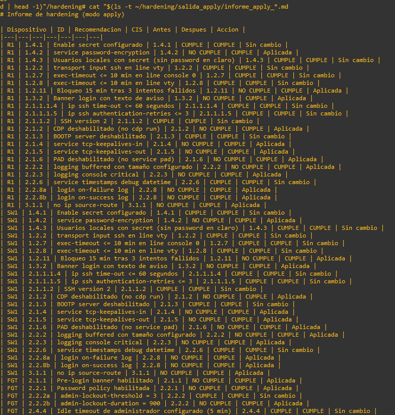

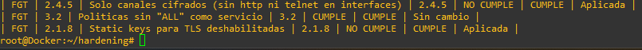

| Equipo | Antes | Después |
|--------|-------|---------|
| R1 | 10/22 | 22/22 |
| SW1 | 10/22 | 22/22 |
| FortiGate | 3/8 | 8/8 |

---

## Pruebas de las recomendaciones

Se comprobó el efecto de las recomendaciones aplicadas con la configuración antes y después de cada equipo, que el script guarda en `salida/configs/`, y con los informes de auditoría de la sección anterior.

### Cambio forzado de contraseña en el FortiGate (control 2.2.1)

Al aplicar la política de contraseñas, el FortiGate obligó a cambiar la contraseña del usuario `auditor` en el siguiente inicio de sesión y mostró los requisitos que debía cumplir.

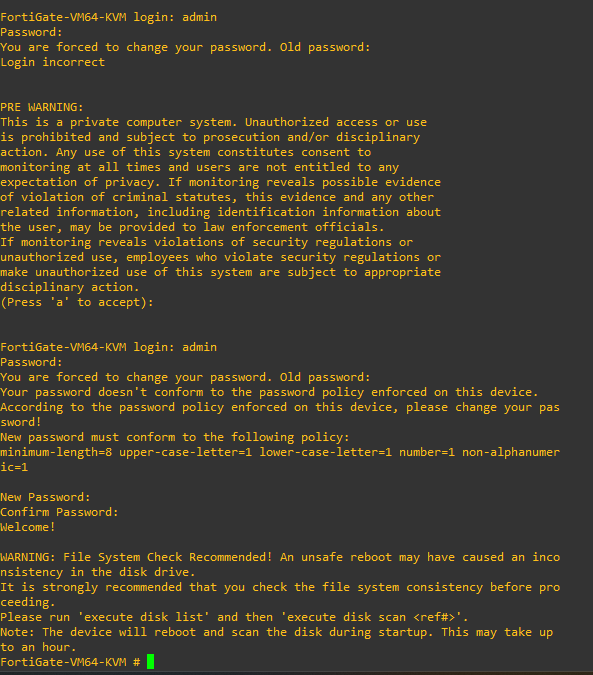
